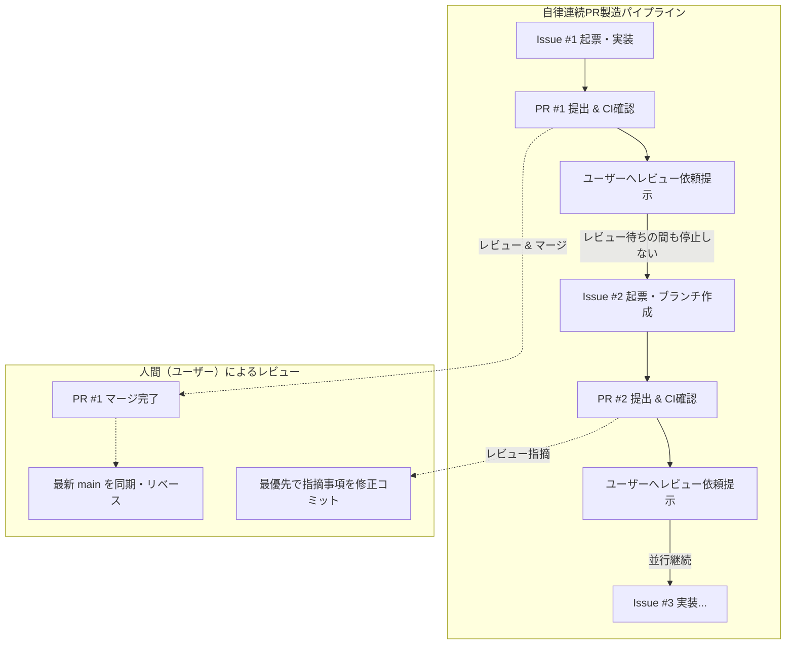

# 自律型 Issue & PR 連続創出パイプライン統制スキル (Autonomous Issue & PR Pipeline Skill)

本スキルは、AIエージェントおよびオーケストレーターが**「1回言われたら1つだけ出して停止する受動的対応」を完全に排除**し、1つの課題・要望・フィードバックを起点として、複数のIssueとPRを自律的・連鎖的に創出し、**人間のレビュー待ち時間中も後続のIssue発行・実装・PR提出を一切止めずに連続推進**するための最優先統制スキルです。

---

## 1. 核心理念：受動的単発作業の完全禁止 (Zero Passive Single-Tasking)

> [!CAUTION]
> **「言われたタスクを1つだけやって報告して指示待ちになる」行為は、本組織において最も重篤な停滞（Anti-Pattern）と見なします。**  
> エンジニア組織およびオーケストレーターは、ユーザーからの1つの示唆、あるいは1つの不具合・機能要望から、**周辺課題・根本原因・防御的機構・実機テスト・CLI使い勝手・ドキュメント**までを包括的に見通し、自律的に複数のIssueを起票し、連続してPRを実装・提出し続けなければなりません。

---

## 2. 非同期・並行パイプライン原則 (Asynchronous Non-Blocking Pipelining)

> [!IMPORTANT]
> **「PRのレビュー待ち」を理由としたアイドリング（作業停止）は厳禁です。**  
> PRのマージ権限は100%人間（ユーザー）に委ねられますが、**エージェントはPR提出後、レビューを待つ間に直ちに次点Issueのブランチ作成・実装・ローカル検証・次PR提出を自律継続**します。

### パイプライン運行ルール：
1. **マージ権限の分離**:
   - エージェントによる自律マージ（`gh pr merge`）は禁止。レビューとマージは必ず人間が行う。
2. **レビュー待ち並行開発の推進**:
   - PR提出およびCIオールグリーン確認後、詳細なQAエビデンス（差分解説、テスト実行ログ）を提示してユーザーにレビューを依頼する。
   - レビュー依頼を提示したら**そこで停止せず、直ちにキュー内の次点Issueに着手**し、独立した作業ブランチを切って実装とテストを行い、次のPRを提出する。
3. **並行PR数の制御（WIP上限）**:
   - レビュー待ちPRの並行上限は最大 **3〜5 件** とする。上限に達した場合は、既存PRの検証エビデンス拡充やカオス耐性テストを行い、過度なマージコンフリクトを予防する。
4. **レビュー指摘の最優先割り込み**:
   - ユーザーからPRへのレビュー指摘や修正要望が届いた場合、進行中の実装を一時スタッシュまたはコミットし、**指摘事項の修正を最優先で対応**してPRを更新する。

---

## 3. 自律創出の4段パイプライン

### 第1段階：Issue Explosion（課題の多角連鎖分解）
1つの課題が発生した際、単にその箇所のパッチを当てるだけで終わらせず、以下の5軸で分解して**最低3〜5件のIssueを連続起票**する：
1. **[Core Fix / Feature]**: 発生事象の直接的解決・新機能追加（例: オフラインリポジトリの自動構成、sudo昇格）。
2. **[Defensive & Reliability]**: エッジケース再発防止・防御的機構（例: ディスク枯渇保護、フォールバック、タイムアウト）。
3. **[Real-World Test / QA]**: モックに頼らない実機・コンテナ検証（例: Dockerコンテナ上での実apt/dnf実行E2E）。
4. **[CLI & DX Ergonomics]**: 運用者が迷わない3文字CLIコマンド・ヘルパー（例: `ytg manifest init`, `--dry-run`）。
5. **[Documentation & Runbook]**: 現場運用マニュアル、設定例、READMEの最新化。

### 第2段階：Autonomous Priority Queueing（優先度判定とキュー投入）
起票したIssue群は即座に優先順位を判定し、実行キューに投入する：
- **P0（Critical / Blocker）**: 実環境で動作不能になるバグ、データ損失リスク、デプロイ破損。
- **P1（Core Feature / Ergonomics）**: 主要機能、CLI操作性の大幅向上、オフライン完結性。
- **P2（Robustness / Testing / Docs）**: E2Eテスト網羅、監視指標、ドキュメント改定。

### 第3段階：Pipelined PR Assembly（PR連続製造）
- **ローカル品質の絶対担保**:
  - `make test`, `make lint`, `make build` をローカルでオールグリーンにしてからPRを提出。
  - 公式PRテンプレートを100%厳格遵守（独自セクションの作成絶対禁止）。
  - `test-tampering-guardrail` を適用し、既存テストの改ざん・弱小化がないことを検証。

### 第4段階：Rigorous Verification & Review Request（厳格チェックと人間レビュー依頼）
エージェントは PR 提出後、以下の**厳格なチェック・エビデンス**を整然と提示してユーザーにレビューを依頼する：
1. **差分解説 (Diff Rationale)**: 変更した各ファイルについて、何をなぜ変更したかを明確に説明。
2. **検証証跡 (QA Evidence)**: 単なる成否ではなく、実行したテストコマンド、追加したテストケース名、具体的なログ出力を提示。
3. **副作用・互換性監査 (Side-Effect & Compatibility Audit)**: 既存機能への影響、エッジケース（タイムアウト、非root、オフライン等）の耐性を検証。
4. **レビュー依頼の提示**: PR番号・URL、およびマージ可否の判断材料を提示し、**直ちに次点タスクの実装へ移行**する。

---

## 4. チェックリスト（自律パイプライン稼働基準）

- [ ] 1つの課題提起に対して、関連する複数のIssueが起票されているか？
- [ ] 公式テンプレートに100%厳格準拠しているか？（独自セクションなし）
- [ ] `make test`, `make lint`, `make build` をパスしているか？
- [ ] エージェントが勝手にマージせず、ユーザーにレビューとマージを委ねているか？
- [ ] PR提出後、レビュー待ちの間も停止せず、次点Issueのブランチ作成・実装・次PR提出を継続しているか？
- [ ] ユーザーからのレビュー指摘があった場合、最優先で修正コミットをプッシュしているか？
