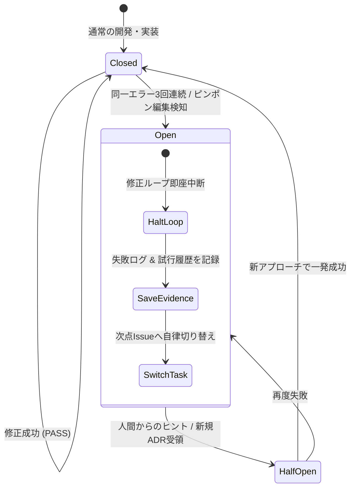

# 無限ループ検知＆サーキットブレーカースキル (Loop Detection & Circuit Breaker Skill)

本スキルは、AIコーディングエージェントが難解なバグや依存関係の不整合に直面した際、**同一エラーの修正試行を際限なく繰り返したり、ファイル間で修正を元に戻して再修正する「無限ループ（Thrashing Loop）」を自動検知して安全に遮断（Circuit Breaker Triggered）**し、組織・パイプライン全体の停滞を防ぐための統制スキルです。

---

## 1. 核心理念：失敗の早期遮断とパイプライン保全 (Fail Fast & Isolate)

> [!CAUTION]
> **同じエラーに対して手当たり次第にパッチを当て続け、3回以上連続で失敗することは重大な資源浪費（Loop Stagnation）です。**  
> 解決策が当たらない場合、それは「微修正」ではなく「前提仮説や根本設計の誤り」を意味します。エージェントは自らループを遮断し、試行履歴をまとめて人間にエスカレーションした上で、**パイプラインを止めずに次の独立したタスクへ自律的に切り替え**なければなりません。

---

## 2. サーキットブレーカーの状態遷移モデル

### 3つの動作状態：
1. **`CLOSED`（閉塞・正常稼働）**:
   - 通常の実装・リファクタリング・テストを進行。各試行のエラーシグネチャをメモリに記録。
2. **`OPEN`（開放・遮断）**:
   - ループ検知条件に合致した瞬間、即座に修正をストップ。
   - 作業中の変更を安全なブランチに退避・コミット。
   - `evidence/circuit-breaker-<issue-id>.md` に試行履歴を自動出力。
   - ユーザーへ状況を報告した上で、**当該Issueでスタックせず、直ちに次の独立したIssueへコンテキストを移行**。
3. **`HALF-OPEN`（半開放・検証試行）**:
   - ユーザーから根本原因のヒントや設計指示（ADR）を受領した後、1回限定で新方針を試行。成功すれば `CLOSED` に復帰。

---

## 3. 無限ループ検知の3大トリガー (Loop Triggers)

以下のいずれかに該当した場合、サーキットブレーカーが即座に `OPEN` となる：

### ① 同一エラー3回連続失敗 (Same Error Threshold: 3)
- コンパイルエラー、テスト失敗（Assertion Failure）、リント警告において、**同一のエラーメッセージ・同一行の失敗が3回連続して解消しなかった場合**。
- ※「エラー文言は変わったが別の箇所が壊れた」現象が4回連続した場合も複合ループとして検知。

### ② ピンポン編集検知 (Ping-Pong Thrashing Detection)
- 直前のステップで修正したコードを元の状態に戻し（Revert）、その後に再度同じような変更を加える「往復編集」が検知された場合。
- 2つのファイル間で型の不整合を押し付け合っている場合（Aを直すとBが壊れ、Bを直すとAが壊れる）。

### ③ 試行ステップ天井 (Max Step Ceiling)
- 1つの不具合修正または機能実装において、コード編集・テスト実行の試行サイクルが通算 **5ステップ** を超えてもグリーンにならない場合。

---

## 4. サーキットブレーカー発動時のプロトコル (`OPEN` 時のアクション)

サーキットブレーカーが発動した場合、エージェントは以下の手順を機械的に実行する：

1. **試行エビデンスの即時作成**:
   - `evidence/circuit-breaker-<issue-id>.md` を作成し、以下を明記する：
     - ① 発生していたエラーの全文とスタックトレース
     - ② 試みたアプローチ（Attempt 1, 2, 3）とそれぞれの失敗理由
     - ③ エージェントが推測する根本原因（根本的な型設計の不一致、外部依存の仕様誤解など）
     - ④ 人間（ユーザー）に判断を仰ぎたい選択肢（Option A: 設計変更, Option B: 仕様縮小など）
2. **作業ツリーの安全退避**:
   - `git checkout -b quarantine/issue-<id>-loop` で試行コードを退避コミットするか、クリーンな直前コミットに `git reset` する。
3. **自律パイプラインの非停止継続 (Zero Pipeline Stall)**:
   - 当該Issueのステータスを `BLOCKED_BY_CIRCUIT_BREAKER` に更新。
   - **作業を止めず、直ちにキュー内の次の独立したIssue（別パッケージ・別機能）の作業に着手し、次PRの作成へ前進する**。

---

## 5. チェックリスト（サーキットブレーカー運用基準）

- [ ] 同じエラーに対して3回以上無目的な修正を繰り返していないか？
- [ ] 直前とほぼ同じコードを行き来するピンポン編集になっていないか？
- [ ] 3回失敗した時点で修正を止め、`evidence/circuit-breaker-*.md` を作成したか？
- [ ] ユーザーへのエスカレーションと同時に、次の独立Issueの実装へ自律切り替えできたか？
- [ ] 人間からの指示受領後に、`HALF-OPEN` として冷静に単発検証を行ったか？
