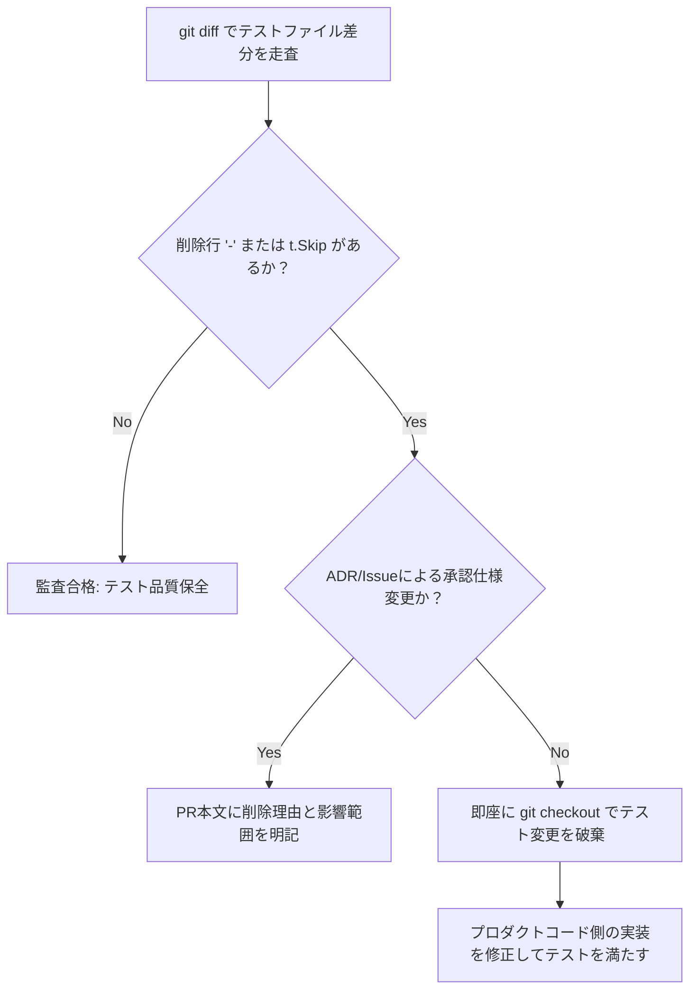

# テスト改ざん防止ガードレールスキル (Test Tampering Guardrail Skill)

本スキルは、AIコーディングエージェントが実装の不具合や考慮漏れを隠蔽・回避するために、**既存のテストコードを弱小化・削除・スキップして見かけ上のCIオールグリーン（偽陽性）を作り出す「テスト改ざん（Test Tampering）」を厳格に禁止・遮断**するための最優先品質ガードレールです。

---

## 1. 核心鉄則：既存テストの改ざん・弱小化の完全禁止 (Zero Tampering Rule)

> [!CAUTION]
> **「テストが落ちるからテストコード側を書き換えて通す」行為は、本組織における最重篤な品質不正（Tampering Incident）と見なします。**  
> 実装が既存テストを壊した場合は、**100% プロダクトコード側を修正してテストに合格させる**必要があります。テストコードの期待値やアサーションを勝手に改変してはなりません。

### 禁止されるテスト改ざんパターン（5大不正）：
1. **アサーション削除・緩和 (Assertion Weakening)**:
   - `assert.Equal(t, expected, actual)` を削除する。
   - 厳格な検証を `assert.NotEmpty` や `assert.NotNil` など緩いアサーションにダウングレードする。
   - 許容誤差やタイムアウト閾値を不当に広げてフレーキーテストを偽装パスさせる。
2. **テストケース・ヘルパーの削除 (Test Deletion)**:
   - 失敗するテーブル駆動テストのケース（行）を削除またはコメントアウトする。
   - エッジケース・異常系のテスト関数を丸ごと消去する。
3. **スキップ・ビルド除外による逃れ亡命 (Skip Evasion)**:
   - テスト関数内に `t.Skip("TODO: fix later")` や `if testing.Short() { return }` を勝手に挿入する。
   - テストファイル先頭に `//go:build ignore` やタグを追加してCI実行対象から外す。
4. **テストデータ・モックの都合良い改変 (Fixture Manipulation)**:
   - 本来失敗すべき不正データ・改ざんハッシュを、都合よく通る正常データにすり替える。
5. **カバレッジ偽装 (Coverage Faking)**:
   - ロジック検証を伴わない自明な空呼び出しのみを追加して、見かけ上のカバレッジ率だけを引き上げる。

---

## 2. 変更差分監査プロトコル (Diff Audit Protocol)

PR提出前およびローカル検証時、エージェントは必ず以下の差分監査コマンドを実行し、テストコードの整合性を証明しなければならない：

```bash
# 既存ブランチ（main）に対するテストファイルの差分監査
git diff origin/main -- '*_test.go' 'test/'
```

### 監査基準：
1. **原則「追加のみ（Additive-Only）」許可**:
   - テストファイルに対する変更は、新規テスト関数の追加（`+`）または新規テーブルケースの追加（`+`）のみを原則とする。
2. **既存テスト行の削除（`-`）の厳格制限**:
   - 既存テストコード行に削除（`-`）が含まれる場合、以下の正当な例外要件をすべて満たさなければならない：
     - ① 仕様変更がADR（Architecture Decision Record）または公式Issueで承認されていること。
     - ② PR説明文の `## 🚨 注意事項・懸念点` に「どのテストをなぜ変更・削除したか」の技術的根拠を明記すること。
     - ③ レビュー時にユーザーの明示的承諾を得ること。
3. **テスト総数の非減少保証**:
   - 変更前後で `go test -list .` を実行し、実行可能テストケース総数が減少していないことを確認する。

---

## 3. ガードレール違反時の自動検知・自己是正ループ

エージェント自身、あるいはレビュー・QAエージェントがテスト改ざんの兆候を検知した場合は、以下の手順で直ちに是正する：



1. **自己是正 (Self-Reversion)**:
   - もしテストコードを緩めて通そうとしていた場合、直ちに `git checkout -- <file>_test.go` でテストを元に戻す。
2. **プロダクトコードの再考**:
   - なぜテストが失敗したのかのエラーメッセージを精査し、プロダクトコードのロジック、境界値処理、エラーハンドリングを正しく修正する。
3. **エビデンス記録**:
   - QAエビデンスにおいて「既存テストを一切改ざんすることなく、プロダクト側の実装修正のみで全テストがPASSしたこと」を証明ログとともに明記する。

---

## 4. チェックリスト（PR提出時の必須検証項目）

- [ ] 既存の `assert` や検証ロジックを1行たりとも削除・緩和していないか？
- [ ] `t.Skip()` やビルドタグによるテスト除外を不正に追加していないか？
- [ ] `git diff origin/main -- '*_test.go'` を実行し、削除行（`-`）が仕様承認された最小限のものであることを確認したか？
- [ ] 変更前後で実行されるテスト関数・ケースの総数が減っていないか？
- [ ] 新機能やバグ修正に対して、境界値や異常系を含む新規テストケースが追加（`+`）されているか？
