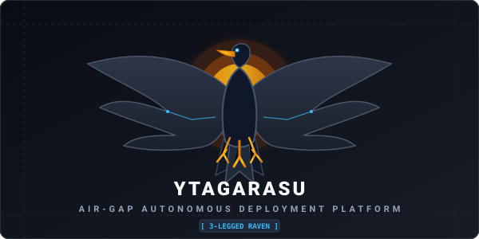

# 🐦‍⬛ ytagarasu (八咫烏)

<p align="center">
  
</p>

<p align="center">
  <a href="README.md"><b>🇯🇵 日本語</b></a> | <a href="README.en.md"><b>🇺🇸 English</b></a>
</p>

<p align="center">
  <a href="https://github.com/sh0jitmy/ytagarasu/actions/workflows/ci.yml"></a>
  <a href="https://github.com/sh0jitmy/ytagarasu/actions/workflows/lint.yml"></a>
  <a href="https://pkg.go.dev/github.com/sh0jitmy/ytagarasu"></a>
  <a href="LICENSE"></a>
</p>

**ytagarasu (八咫烏 - The Three-Legged Raven)** is a highly reliable, autonomous deployment platform purpose-built for **strictly air-gapped (completely offline)** environments.

In critical closed networks—such as financial systems, medical facilities, energy grids, industrial automation, and defense operations—ytagarasu bundles recursively resolved package dependencies, application binaries, configuration templates, and TLS certificates into a single cryptographically signed archive. It delivers an end-to-end operational pipeline from physical media transport (USB/SSD) to offline distribution servers, automated client agent rollouts, atomic rollbacks, tamper-evident audit hashing, and ultra-lightweight process supervision via a single binary.

---

## 🏛️ Overall Architecture

```
 [ Online Build / Preparation Host ]
        │
        ├── 1. manifest.yaml definition & preflight risk evaluation (ytagarasu manifest init / eval)
        ├── 2. APT / RPM dependency recursive resolution & caching (pkgengine)
        ├── 3. Ed25519 digital signature & full/delta bundle generation (ytagarasu bundle export)
        │
 ═══════╪════════════════════════════════════════════════════════════════════════
        │  Physical Media Transport (Encrypted USB / External Storage)
 ═══════╪════════════════════════════════════════════════════════════════════════
        ▼
 [ Offline / Air-Gapped Environment ]
        │
   ┌────┴───────────────────────────────────────────────────────────────────┐
   │ 4. Offline Distribution Server (ytagarasu-server)                      │
   │    ├── Cryptographic signature & expiration validation pipeline        │
   │    ├── Content-Addressable Storage (SHA-256 CAS)                       │
   │    ├── Pure Go CGO-free WAL SQLite release management & virtual repos   │
   │    ├── Tamper-evident SHA-256 audit hash-chain (/api/v1/audit/...)     │
   │    ├── Prometheus-compatible metrics (/metrics) & health probes        │
   │    └── Zero-CDN embedded HTMX operational dashboard (/ui)              │
   └────┬───────────────────────────────────────────────────────────────────┘
        │ HTTP (Desired State Polling)
        ▼
   ┌────────────────────────────────────────────────────────────────────────┐
   │ 5. Autonomous Agent & Process Supervisor (ytagarasu-agent / ytg)       │
   │    ├── 3-character headless CLI 'ytg' (status, inspect, restart)       │
   │    ├── Internal zero-cron log rotation & disk space protection         │
   │    ├── Linux cgroup v2 memory.events monitoring & OOM recovery         │
   │    ├── flock mutual exclusion guard preventing concurrency races       │
   │    ├── Non-interactive package installation (DEBIAN_FRONTEND / -y)     │
   │    ├── renameat atomic swap & immediate snapshot recovery on failure   │
   │    └── Pre/post HTTP & command health probes                           │
   └────────────────────────────────────────────────────────────────────────┘
```

---

## ✨ Key Features

1. **📦 Multi-Ecosystem Packaging & Recursive Dependency Resolution**:
   - Manages APT (`dpkg`, `apt-get`), RPM/DNF, Python Wheels (`pip --no-index`), and Docker container images (`docker load`) under a unified declarative manifest.
   - Recursively pre-resolves and bundles all transitive dependencies online, enabling seamless zero-network offline installation.
2. **🛡️ Cryptographic Integrity & Tamper Protection**:
   - Ed25519 asymmetric signatures and SHA-256 content-addressable storage (CAS). Corrupted or altered bundles are blocked immediately at the boundary.
   - Built-in `ExpiresAt` expiration checks protect against unauthorized delivery and replay attacks.
3. **🔄 Atomic Blue/Green Rollouts & Instant Rollback**:
   - Atomic directory swaps using `renameat` ensure zero service disruption.
   - Automatic pre-deployment snapshots provide immediate rollback if health probes or syntax validation fails.
4. **🦅 3-Character Headless CLI `ytg` & Micro-Supervisor**:
   - Single-binary process supervisor replaces heavy orchestrators on resource-constrained on-premise servers.
   - Monitors child processes, auto-restarts on unexpected exits, enforces cgroup v2 memory limits, and rotates logs without external cron daemons.
5. **🔍 Automatic Manifest Discovery & Whitelist Generation**:
   - Automatically surveys running legacy servers (`ytagarasu discover survey`) and generates clean manifests following strict KISS whitelist principles.
6. **🐳 Docker Container Support & Zero-Engine Migration**:
   - Automatically saves and loads container images (`docker save / load`), integrates container health with supervisor lifecycle, and translates legacy `docker-compose.yml` into native ytagarasu specs (`ytg manifest convert`).

---

## 📸 Screenshots

| Offline Distribution Dashboard (`/ui`) | Tamper-Evident Audit Chain (`/ui/audit`) | 🔍 Manifest Discovery (`/ui/discover`) |
| :---: | :---: | :---: |
|  |  |  |

---

## 🚀 5-Minute Quick Start

### 1. Clone & Build
```bash
git clone https://github.com/sh0jitmy/ytagarasu.git
cd ytagarasu
make build
```
Binaries will be generated in `bin/`:
- `bin/ytg`: Lightweight headless CLI & process supervisor
- `bin/ytagarasu`: Bundle creation, verification, and audit CLI
- `bin/ytagarasu-server`: Offline distribution server & HTMX dashboard
- `bin/ytagarasu-agent`: Node deployment agent

### 2. Headless Operations with `ytg`
```bash
# Enable shell auto-completion (Bash example)
source <(./bin/ytg completion bash)

# Run autonomous supervisor from manifest
./bin/ytg supervisor run -c manifest.yaml

# Check running processes, uptime, and restarts
./bin/ytg status

# Inspect specific service metrics and config
./bin/ytg inspect backend-api

# Safely restart a managed process
./bin/ytg restart backend-api
```

### 3. Launch Offline Distribution Server
```bash
./bin/ytagarasu-server --listen :8080 --data-dir ./data/server
```
Visit `http://localhost:8080/ui` in your browser for the embedded dashboard.
Prometheus metrics: `http://localhost:8080/metrics`, health probe: `http://localhost:8080/livez`.

### 4. (Optional) Reverse Engineer Legacy Configurations
```bash
# Step 1: Survey existing server non-intrusively (Read-Only)
./bin/ytagarasu discover survey -o discovery-plan.yaml

# Step 2: Review discovery-plan.yaml and comment/delete unwanted items (KISS whitelist)

# Step 3: Generate manifest.yaml and ingest binaries (--ingest)
./bin/ytagarasu discover generate -p discovery-plan.yaml -o manifest.yaml --ingest
```

### 5. Generate Ed25519 Signing Keypair
```bash
./bin/ytagarasu keygen -d ./keys
```

### 6. Create & Sign a Deployment Bundle
```bash
./bin/ytagarasu bundle export \
    --manifest examples/manifest.yaml \
    --source examples/ \
    --output ./bundle-v1.0.0.tar.gz \
    --key ./keys/private.key \
    --force
```

### 7. Import Bundle to Offline Server
Drag & drop via Web UI (`http://localhost:8080/ui`) or upload with curl:
```bash
curl -X POST http://localhost:8080/api/v1/bundles/import \
    -F "bundle=@./bundle-v1.0.0.tar.gz"
```

### 8. Deploy via Agent
```bash
./bin/ytagarasu-agent \
    --server http://localhost:8080 \
    --service billing-svc \
    --once
```

### 9. Verify Tamper-Proof Audit Chain
```bash
./bin/ytagarasu audit verify --server http://localhost:8080
```
Confirms integrity with `✅ Audit trail is VALID and tamper-free!`.

---

## 🧪 Multi-Tier E2E Testing Framework

| Tier | Command | Scope | Trigger |
| :--- | :--- | :--- | :--- |
| **Tier 1** | `make test` | Unit & Integration tests (`-race`, 100% target coverage) | PR / Local Dev |
| **Tier 2** | `make sqlite-e2e` | Standalone Pure Go SQLite governance & backup verification | PR CI / Local |
| **Tier 3** | `make ytagarasu-e2e` | **Agent-Server rollouts, manifest discovery & HTMX UI E2E** | PR CI / Pre-merge |
| **Tier 4** | `make frontend-e2e` | Headless Chrome UI snapshot audits & static HTML portal generation | PR CI / Visual Audit |
| **Tier 5** | `make matrix-test` | **Full package matrix (APT, DNF, Pip, Docker, Dewy) E2E verification** | Manual / Weekly CI |

> **🌐 Live E2E Verification Portal & Snapshots**:
> - 🏠 **Comprehensive E2E Portal**: [https://sh0jitmy.github.io/ytagarasu/](https://sh0jitmy.github.io/ytagarasu/)
> - 🔍 **ytagarasu UI & Discovery Report**: [https://sh0jitmy.github.io/ytagarasu/ytagarasu_ui_e2e_report.html](https://sh0jitmy.github.io/ytagarasu/ytagarasu_ui_e2e_report.html)
> - 📦 **Matrix Package Verification Report**: [https://sh0jitmy.github.io/ytagarasu/matrix_test_report.html](https://sh0jitmy.github.io/ytagarasu/matrix_test_report.html)
> - 🖥️ **Standalone HTMX Frontend Report**: [https://sh0jitmy.github.io/ytagarasu/frontend_e2e_report.html](https://sh0jitmy.github.io/ytagarasu/frontend_e2e_report.html)

---

## 📖 Documentation & Architecture Reference

- 📘 **[Comprehensive User Manual (docs/manual.md)](docs/manual.md)**:
  - End-to-end operational flow from online build to air-gapped deployment
  - Delta bundle creation and patching strategy
  - Ansible provisioning playbooks
  - Configuration syntax preflight validation and rollback architecture
  - Cryptographic audit trail recovery procedures
  - CLI command and YAML specification reference
- 💾 **[Air-Gap USB Export, Verification & Deployment Specification (docs/airgap-usb-docker-hybrid-test-scenarios-and-usecases.md)](docs/airgap-usb-docker-hybrid-test-scenarios-and-usecases.md)**:
  - Online media export pipeline for USB/physical drives (binaries, container tars, manifests, signatures)
  - Offline air-gap cryptographic verification & anti-tamper validation
  - Docker hybrid architectures (PostgreSQL 16, Grafana) & supervised on-premise OSS (Musubi)
  - E2E scenario testing specifications and 7-phase validation criteria

---

## 📄 License

Apache License 2.0 - See [LICENSE](LICENSE) for details.
