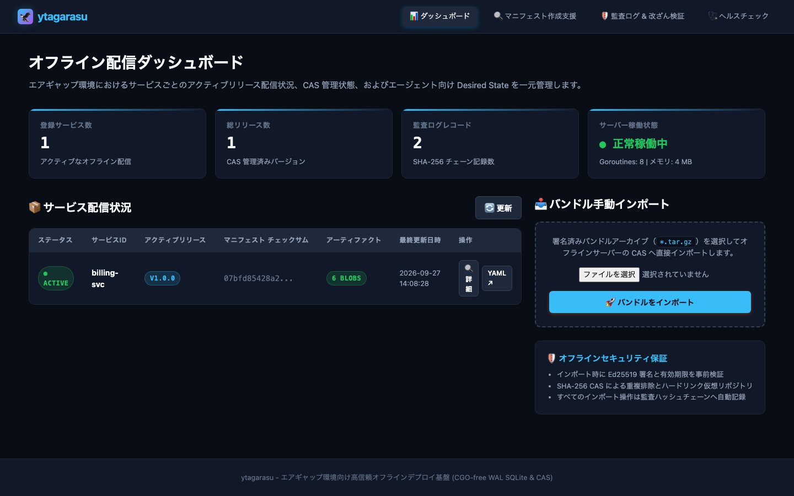
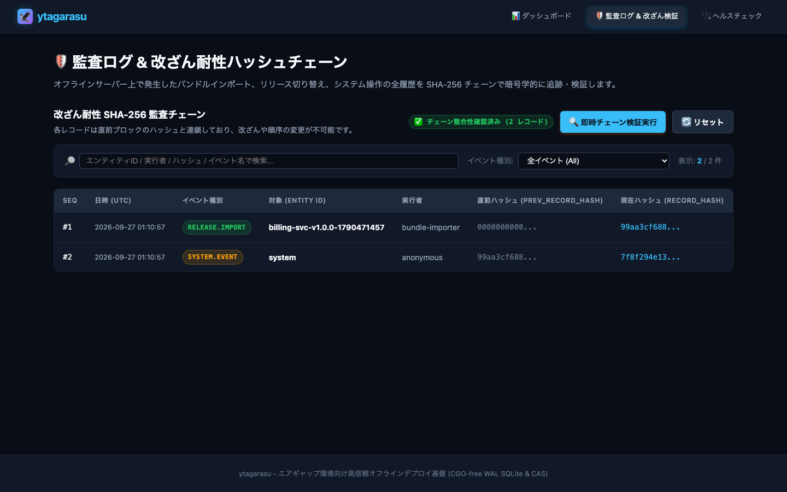
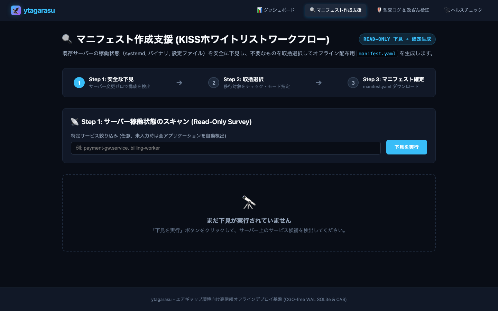

# 🦅 ytagarasu (八咫烏)

[](https://github.com/sh0jitmy/ytagarasu/actions/workflows/ci.yml)
[](LICENSE)
[](https://goreportcard.com/report/github.com/sh0jitmy/ytagarasu)

**ytagarasu（八咫烏）** は、インターネット接続が完全に遮断された**エアギャップ（完全オフライン）環境**のための、高信頼・自律型デプロイメント基盤プラットフォームです。

金融・医療・エネルギー・制御システム・製造工場などの閉域ネットワークにおいて、再帰的依存解決済みパッケージ、アプリケーション成果物、設定テンプレート、TLS 証明書をひとつの暗号署名付きバンドルにまとめ、物理メディア搬送からサーバー配布、クライアントエージェントによる自動適用・ロールバック・監査トレース、そして単一バイナリによる軽量プロセス監視までをエンドツーエンドで完結させます。

---

## 🏛️ 全体アーキテクチャ

```
 [ オンライン・ビルド環境 ]
        │
        ├── 1. manifest.yaml 定義 & 事前リスク評価 (ytagarasu manifest init / eval)
        ├── 2. APT / RPM 依存関係の再帰的解決 & キャッシュ (pkgengine)
        ├── 3. Ed25519 デジタル署名 & フル/差分バンドル生成 (ytagarasu bundle export)
        │
 ═══════╪════════════════════════════════════════════════════════════════════════
        │  物理メディア搬送 (USB / 外付け暗号化ストレージ)
 ═══════╪════════════════════════════════════════════════════════════════════════
        ▼
 [ オフライン・エアギャップ環境 ]
        │
   ┌────┴───────────────────────────────────────────────────────────────────┐
   │ 4. オフライン成果物サーバー (ytagarasu-server)                          │
   │    ├── 署名・有効期限の検証パイプライン                                 │
   │    ├── コンテンツアドレス可能ストレージ (SHA-256 CAS)                  │
   │    ├── CGO-free WAL SQLite リリース管理 & 仮想リポジトリ (/repos/...)   │
   │    ├── 改ざん耐性 SHA-256 監査ハッシュチェーン (/api/v1/audit/...)     │
   │    ├── Prometheus 互換メトリクススクレイプ (/metrics) & ヘルスプローブ  │
   │    └── Node.js不要の組み込み HTMX ダッシュボード (/ui)                 │
   └────┬───────────────────────────────────────────────────────────────────┘
        │ HTTP (Desired State Polling)
        ▼
   ┌────────────────────────────────────────────────────────────────────────┐
   │ 5. 自律型デプロイエージェント & スーパーバイザー (ytagarasu-agent / ytg)│
   │    ├── 3文字CLI 'ytg' によるヘッドレス運用 (status, inspect, restart)   │
   │    ├── 外部cron不要の内蔵型極小ログローテーション & ディスク保護       │
   │    ├── Linux cgroup v2 memory.events 監視 & OOM Killer 自律復旧        │
   │    ├── flock 多重実行ガードによる競合防止                              │
   │    ├── 非対話的パッケージインストール (DEBIAN_FRONTEND / -y)           │
   │    ├── renameat 不可分更新 & 失敗時の即座スナップショット復元          │
   │    └── HTTP / コマンドによるポスト健全性プローブ (HealthCheck)         │
   └────────────────────────────────────────────────────────────────────────┘
```

---

## ✨ 主要機能

1. **📦 多種パッケージエコシステム対応 & 再帰的依存解決**:
   - APT (`dpkg`, `apt-get`)、RPM/DNF、Python Wheels（Pip `--no-index`）、Docker コンテナイメージ（`docker load`）を単一マニフェストで統括。
   - インターネット側で推移的依存関係を事前解決・一括アーカイブし、完全閉域でのオフライン導入を実現。
2. **🛡️ 暗号学的完全性 & 有効期限検証**:
   - Ed25519 によるデジタル署名と公開鍵検証。改ざんされたバンドルはインポート段階で即座に遮断。
   - マニフェスト内の有効期限（`ExpiresAt`）チェックによる誤搬送・リプレイアタックの防止。
3. **🔗 改ざん耐性 SHA-256 監査ハッシュチェーン**:
   - バンドルインポート、リリース切り替え、エージェントデプロイ結果の全履歴を直前ブロックのハッシュと連鎖記録。
4. **⚡ 3文字CLI `ytg` によるヘッドレス運用 & プロセススーパーバイザー**:
   - TeraTerm や RS-232C シリアルコンソール経由で作業する保守員のため、最頻出コマンド `ytg status`、プロセス詳細診断 `ytg inspect <name>`、および `ytg restart <name|--all>` をルート直下で提供。
   - Bash, Zsh, PowerShell, Fish に対する完全なシェル自動補完スクリプト生成（`ytg completion <shell>`）。
5. **🔄 閉域網向け内蔵型極小ログローテーション & ディスク保護**:
   - 外部 `logrotate` や `crond` が存在しない産業用PC・アプライアンスでも、標準ライブラリのみで自動ログローテーション（`RotatingWriter`）とバックグラウンド gzip 圧縮を実現。
   - ディスク使用率が安全閾値（デフォルト 90%）を超過した場合の書き込み抑止・自己保護機能を内蔵。
6. **🚨 Linux cgroup v2 `memory.events` 監視 & OOM Killer 自律復旧**:
   - OS カーネルの cgroup v2 インターフェースを監視し、OOM Killer による強制終了を `memory.events` の `oom_kill` カウンタから即座に検知・自動再起動。
7. **📈 Prometheus 互換 `/metrics` & ネイティブ L4/L7 ヘルスプローブ**:
   - NIST SP 800-82（OT セキュリティ標準）に準拠し、外部 SaaS 依存ゼロで Prometheus Exposition Format のプレーンテキスト `/metrics` を直接提供。
   - ロードバランサやコンテナオーケストレータ向けの標準ヘルスチェック（`/healthz`, `/livez`, `/readyz`）を完備。
8. **🔍 既存サーバーからのマニフェスト作成支援 (KISSホワイトリスト・リバースエンジニアリング)**:
   - 既存サーバーで稼働中の `systemd` サービス、バイナリ、設定ファイルを安全に下見（`survey`）し、不要なものを取捨選択して `manifest.yaml` を確定生成（`generate`）。
   - **Mode A (実体吸い上げ / `--ingest`)**: バイナリや設定ファイルを自動取得して即座にバンドル化可能。
   - **Mode B (デフォルト)**: CI/CD リポジトリの配置を促す `# TODO: <url>` ヒントを出力。
   - **SIRT 安全弁**: 設定ファイル内の機密情報（パスワード・秘密鍵・トークン等）を `<REDACTED_SECRET>` に自動マスキング。
   - **Web UI 連携**: `/ui/discover` からブラウザ上で下見・選択・ワンクリックダウンロード（`manifest.yaml`）が可能。
9. **📊 組み込み HTMX ダッシュボード & サービスインスペクト (Node.js/npm 完全不要)**:
   - `//go:embed` によりアセット（HTMX、CSS）を Go 単一バイナリに内包。外部 CDN 接続ゼロ。
   - サービス一覧、Desired State、稼働メトリクス、監査ログ、バンドル手動インポートを Web ブラウザから確認可能。
10. **🤖 初期ブートストラップ Ansible Role**:
   - `roles/deploy_agent/` により、ベアメタルや仮想マシンへの `ytagarasu-agent` のバイナリ配置、設定展開、systemd ユニット登録を自動化。

---

## 📸 スクリーンショット

| オフライン配信ダッシュボード (`/ui`) | 監査ログ & 改ざん耐性チェーン (`/ui/audit`) | 🔍 マニフェスト作成支援 (`/ui/discover`) |
| :---: | :---: | :---: |
|  |  |  |

---

## 🚀 5分で体験するクイックスタート

### 1. リポジトリのクローン & ビルド
```bash
git clone https://github.com/sh0jitmy/ytagarasu.git
cd ytagarasu
make build
```
`bin/` ディレクトリに以下の実行バイナリが生成されます：
- `bin/ytg`: 軽量ヘッドレス CLI & プロセススーパーバイザー
- `bin/ytagarasu`: バンドル作成・検証・監査 CLI
- `bin/ytagarasu-server`: オフライン成果物サーバー & HTMX ダッシュボード
- `bin/ytagarasu-agent`: ノード常駐デプロイエージェント

### 2. 3文字CLI `ytg` によるヘッドレス運用
```bash
# シェル自動補完の適用 (Bash の例)
source <(./bin/ytg completion bash)

# マニフェストに基づくプロセスの自律監視起動
./bin/ytg supervisor run -c manifest.yaml

# 稼働中プロセスの状態・稼働時間・再起動回数の一覧確認
./bin/ytg status

# 特定プロセスの詳細メトリクス・設定の診断
./bin/ytg inspect backend-api

# プロセスの安全な再起動
./bin/ytg restart backend-api
```

### 3. 成果物サーバーの起動
```bash
./bin/ytagarasu-server --listen :8080 --data-dir ./data/server
```
ブラウザで `http://localhost:8080/ui` にアクセスすると、組み込みダッシュボードが表示されます。
また、Prometheus メトリクスは `http://localhost:8080/metrics`、死活監視プローブは `http://localhost:8080/livez` で取得可能です。

### 4. (任意) 既存サーバーからのマニフェスト自動作成（リバースエンジニアリング）
Web UI（`http://localhost:8080/ui/discover`）のウィザードを使用するか、CLI で既存サーバーの構成を安全に吸い上げます：
```bash
# Step 1: 稼働中サービスの構成を安全に下見 (Read-Only)
./bin/ytagarasu discover survey -o discovery-plan.yaml

# Step 2: discovery-plan.yaml を確認し、不要な行を削除/コメントアウト (KISSホワイトリスト)

# Step 3: manifest.yaml を確定生成 (実体吸い上げモード: --ingest)
./bin/ytagarasu discover generate -p discovery-plan.yaml -o manifest.yaml --ingest
```

### 5. バンドル署名用の鍵ペア生成
```bash
./bin/ytagarasu keygen -d ./keys
```

### 6. サンプルバンドルの作成・署名・エクスポート
```bash
./bin/ytagarasu bundle export \
    --manifest examples/manifest.yaml \
    --source examples/ \
    --output ./bundle-v1.0.0.tar.gz \
    --key ./keys/private.key \
    --force
```

### 7. サーバーへのバンドルインポート
Web UI（`http://localhost:8080/ui`）からファイルをドラッグ＆ドロップするか、curl でアップロードします：
```bash
curl -X POST http://localhost:8080/api/v1/bundles/import \
    -F "bundle=@./bundle-v1.0.0.tar.gz"
```

### 8. クライアントエージェントによる適用
```bash
./bin/ytagarasu-agent \
    --server http://localhost:8080 \
    --service billing-svc \
    --once
```

### 9. 監査ハッシュチェーンの改ざん検証
```bash
./bin/ytagarasu audit verify --server http://localhost:8080
```
`✅ Audit trail is VALID and tamper-free!` と表示され、完全性が確認できます。

---

## 🧪 多層 E2E テストフレームワーク

本リポジトリは、閉域環境における極めて高い信頼性を担保するため、多層 E2E テストスイートを完備しています：

| レイヤー | コマンド | 検証内容 | 実行タイミング |
| :--- | :--- | :--- | :--- |
| **Layer 1** | `make test` | 単体・結合テスト（`-race`、メモリDB分離、カバレッジ 100%） | PR / ローカル開発 |
| **Layer 2** | `make sqlite-e2e` | No-Docker スタンドアロン SQLite ガバナンス・バックアップ検証 | PR CI / ローカル検証 |
| **Layer 3** | `make ytagarasu-e2e` | **Agent-Server 実機デプロイ動作、マニフェスト作成支援 & HTMX UI 一括 E2E 検証** | PR CI / マージ前検証 |
| **Layer 4** | `make frontend-e2e` | Headless Chrome による自動スナップショット撮影 & 統合 HTML ポータル生成 | PR CI / 視覚監査 |
| **Layer 5** | `make matrix-test` | **全パッケージ種別網羅（APT, DNF, Pip, Docker, Dewy）E2E 検証** | 手動実行 / 週次定期 CI |

```bash
# Agent-Server 実機動作および HTMX UI（マニフェスト作成支援含む）の完全な E2E テストを実行
make ytagarasu-e2e

# 全パッケージエコシステム（APT, DNF, Pip, Docker, Dewy）のマトリクステストを手動実行
make matrix-test
```

> **🌐 Live E2E Verification Report & UI Snapshots**:
> Headless Chrome で自動撮影されたダッシュボード・監査チェーン・マニフェスト作成支援 UI のスナップショットと各種検証結果は、GitHub Pages にて常時公開・相互リンクされています：
> - 🏠 **総合 E2E ポータル**: [https://sh0jitmy.github.io/ytagarasu/](https://sh0jitmy.github.io/ytagarasu/)
> - 🔍 **ytagarasu UI & マニフェスト作成支援 E2E レポート**: [https://sh0jitmy.github.io/ytagarasu/ytagarasu_ui_e2e_report.html](https://sh0jitmy.github.io/ytagarasu/ytagarasu_ui_e2e_report.html)
> - 📦 **全パッケージ網羅マトリクス詳細レポート**: [https://sh0jitmy.github.io/ytagarasu/matrix_test_report.html](https://sh0jitmy.github.io/ytagarasu/matrix_test_report.html)
> - 🖥️ **スタンドアロン HTMX Frontend E2E レポート**: [https://sh0jitmy.github.io/ytagarasu/frontend_e2e_report.html](https://sh0jitmy.github.io/ytagarasu/frontend_e2e_report.html)

---

## 📖 ユーザーマニュアル & ドキュメント

より詳細な運用手順、設定リファレンス、およびトラブルシューティングについては、以下のマニュアルを参照してください：

- 📘 **[詳細ユーザーマニュアル (docs/manual.md)](docs/manual.md)**:
  - エンドツーエンドの運用フロー（オンライン作成からオフライン適用）
  - 差分バンドルの作成・運用方法
  - Ansible による初期導入手順
  - 設定構文事前検証と自動ロールバックの設計
  - 監査チェーンの仕組みと復旧手順
  - CLI コマンドおよび設定ファイル（YAML）完全リファレンス

---

## 📄 ライセンス

Apache License 2.0 - 詳細は [LICENSE](LICENSE) を参照してください。
